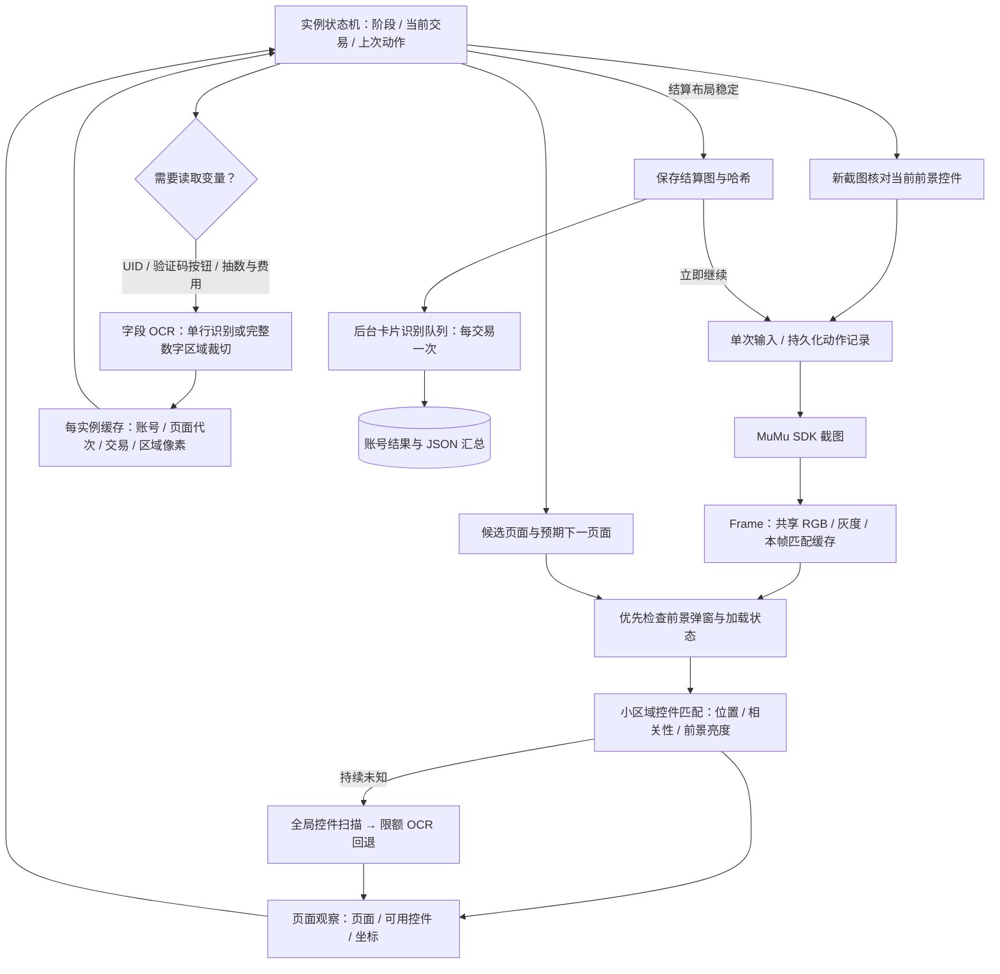

# UI 观察框架

运行实现位于 `ournotes/ui/`，独立于卡面识别、邮箱接口和交易数据库。这里是普通 Python、OpenCV 和本地 OCR；运行时不需要 LLM。设计借鉴 ALAS 的控件素材、区域识别、页面导航与输入节流思想，未复制其游戏规则。设计以当前代码和下述边界为准。

## 模块边界

| 文件 | 职责 |
|---|---|
| `ui/frame.py` | 单帧对象、共享像素转换、匹配缓存；输入后下一帧重新建立 |
| `ui/elements.py` | 加载控件素材；在预定区域附近匹配，检测区域与点击区域可分别配置 |
| `ui/pages.py` | 按业务阶段和上次动作选择候选页面；弹窗、网络错误和加载优先 |
| `ui/observer.py` | 页面观察、有限回退、按需读取字段、输入前核验 |
| `ui/fields.py` | 单行 OCR、完整数字字段裁切、区域与业务作用域缓存 |
| `assets/ui/manifest.json` | 素材路径、来源、检测范围、点击范围、阈值、页面锚点和控件 |
| `ournotes/runtime/runner.py` | 业务状态机、交易核对、导航重试、重复演出与奖励的操作期限 |
| `ournotes/runtime/pools.py` | 卡池身份与侧栏位置，保持按身份选池，允许排序和数量改变 |
| `ournotes/runtime/pool_navigation.py` | 侧栏稳定观测、滑动反馈、两端确认与逐交易扫描状态 |
| `ournotes/vision/ocr.py` | 低频恢复路径，保留原 OCR 分类器作为未知页的辅助识别 |

素材数组共享只读，Frame 匹配结果、页面代次、字段缓存和动作冷却均属于单个实例。没有跨模拟器复用可变坐标或识别结果。

## 正常路径

已知页面只检查少量固定控件。背景动画不参加页面缓存判断，也不参加菜单点击前核验。模板相关性之外还检查亮部的绝对强度，避免把弹窗下方变暗的页面当作可点击前景。加载提示优先于背景标题按钮；黑白过渡帧只等待，不消耗 OCR 回退预算。

全屏 OCR 不参与正常按钮查找。UID、邮箱/验证码占位文字、发送按钮，以及抽卡确认标题、数量、支付方式和余额在业务真正需要时读取。支付验证逐笔进行，不跨账号或交易复用；两处付费余额都必须明确读为 0。数字裁切先覆盖整个金额区域，再找到所有字符，不能只截取尾部的 0。

字段缓存要求作用域相同且对应区域的像素完全一致。卡池选择需至少两次位置一致、跨度达到 0.3 秒的观测；确认框仍核对目标池、抽数和券/免费星钻，不因为识别变快而省略交易检查。

卡池扫描先向列表下方寻找目标，再在需要时反向浏览。每次只提交一个滑动，实际发送成功才计数；后续持续截图确认位置变化并稳定。滑动后的旧帧、空识别结果、只有卡池名称相同但坐标改变，都不能作为列表边界。无位移需观察满 1.5 秒，再用同方向第二次滑动复核；上下两端都确认后才可标记目标缺失。24 次滑动仍未确认完整遍历时暂停并保留计划，不推断卡池失效。这里的期限是非阻塞反馈检查，没有固定业务 Sleep。

扫描进度绑定交易 ID，随账号检查点持久化；新交易不继承旧列表边界。重启时丢弃未确认滑动的反馈推断，离线期间经过的时间不能证明已经到达边界。回放素材位于 `assets/reference/runtime-regressions/pool-scan/`，用于真实卡池滑动与边界判断回归。

## 未知页面、重复动作与恢复

- 当前候选未命中时先继续采样。持续未知 0.8 秒后，最多每 0.5 秒扫一次全部页面模板，并包含独立的结算布局检测。
- 持续未知 3 秒后可调用 OCR；间隔至少 10 秒，每段连续未知最多 3 次，每账号最多 12 次。已知页面不会每帧重复全屏 OCR。OCR 结果保留恢复模式，不被标记为快速模板命中；切换账号时重置未知计时及兜底节流。
- OCR 兜底仍须通过点击前的图像前景校验，不能绕过遮挡或未知控件。礼物箱关闭及结算页左右两种布局的招募 TOP 均识别按下状态；按下滞留时先持久化一次释放标记，再释放触摸，不重新领取或提交抽卡。礼物箱标记绑定账号，结算标记绑定原交易。
- 导航操作设冷却和重试上限。连续领取奖励、逐张跳过演出有独立冷却和 60 秒重复操作期限，每次仍检查新截图中的前景。
- 观察采样目标间隔为 0.1 秒，等待验证码时为 0.25 秒。这是采样节流，不代表 UI 已经完成。流程进展由当前画面和 API 结果决定。
- 未知页面/操作无进展超时会保存现场并暂停。已提交而未取得结算证据的交易绝不自动重抽。模拟器关闭后，游戏可能不恢复结算页；本地持久化不能补造丢失的服务器结果。

## 素材维护与验证

新增页面先保存完整截图，再从稳定标题、图标或按钮裁切控件。检测范围尽量小，避免角色、数字和发光粒子。不同布局建立独立变体；不要简单放宽全部阈值。本机异常截图保留完整原始画面，不遮盖邮箱、验证码或提示区域，以便核对输入与短暂错误提示；旧版已遮盖的图片无法恢复，被遮挡区域不能作为控件素材。

开屏宣传视频使用 `opening_movie` / `opening_skip_confirm`，与抽卡 `animation` 分开。联合识别快进图标和中文“跳过”，确认弹窗使用固定标题、问题正文和 OK，不以单个通用 OK 判断页面。相关素材及不同视频帧、活动横幅回放位于 `assets/reference/runtime-regressions/opening-updates/`；测试同时覆盖背景更换、按钮消失、弹窗遮挡和已提交交易边界。英文 SKIP 活动横幅有独立布局素材，与原有卡池开屏同样在奖励阶段沿用 `skip-opening` 路径，不依赖全屏 OCR。

生日等开屏剧情使用 `story → story_menu → story_skip_confirm`：核验剧情边框和右上角菜单图标，展开菜单后联合核验关闭图标、SKIP 与 AUTO，再点击 SKIP；只有“要跳过故事吗？”正文与“跳过”按钮同时匹配才确认。识别不依赖人物名、台词或角色立绘。每次输入重新核验前景，与开屏视频共用60秒/12次操作预算；有已提交交易时停止核查，不借剧情跳过离开未决结算。原生控件与来自另一实例的独立回放位于 `assets/reference/runtime-regressions/birthday-story/`。

回放应覆盖普通页面、变暗背景、遮挡弹窗、按钮变化、支付字段和多实例缓存隔离。`tests/test_ui_observer.py` 使用保存的真实截图验证这些边界；`tests/test_runner_recovery.py` 验证交易不重发和重复演出操作期限。

`timings.jsonl` 分别记录 `vision`、`field_ocr`、`pool_identity`、截图、输入、保存图像与后台识别。`完整分步骤用时.md` 按动作完成时间列全量步骤，恢复运行按会话分别计时，剔除程序停止期间的时间。嵌套计时与后台任务不能简单相加。

普通页面、操作前画面和确认框截图仅保存在最近 10 秒、最多 30 帧的内存循环缓存。日志记录内存帧 ID，不伪装成磁盘文件路径；异常时输出缓存截图及帧 ID 对照表，运行资料按 `config/storage-policy.json` 保留最近3个已结束批次，活动写入者及跨批仍引用的证据额外保护。结算图临时落盘供后台识别和中断恢复，成功账号的简化 JSON 写入后立即删除该账号的结果图及已恢复异常的截图，并清空其内存画面。保留窗口内的识别未完成、待复核、失败或部分完成账号保留证据；更早批次允许清理证据，保留原交易状态和清理审计，恢复及复核入口明确拒绝继续；成功记录中的截图标记为 `removed_after_success`，仅保留历史路径与哈希，不再承诺原图可打开。

## Windows 文件读取与重启验证

状态 JSON 使用临时文件、flush/fsync 与原子替换。Windows 读取程序可能短暂拒绝重命名；针对共享冲突/访问占用在 1 秒限额内退避重试，其余错误仍向上传播，不会截断旧文件。这里的等待是文件系统冲突重试，不是游戏流程的固定等待。

确认按钮尚未提交时重启模拟器，若回到标题页，状态机先重新核对相同 UID，再恢复原计划；不分配新邮箱，不重抽已记录结果。若交易已提交却丢失结算页，保留现场并暂停。两种情况都有回归测试。

下载、标题加载、验证码恢复及受限导航的统一规则见 [运行与恢复](运行与恢复.md)。

资源下载确认页由运行器按已识别的 OK 控件自动确认，继续原账号及计划；APK 更新仍需手动处理。已开始下载的进度观察仍只读取百分比，不以固定等待时间假定下载完成。
